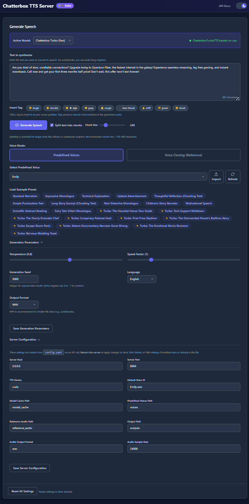

# griot

Local text-to-speech server with zero-shot voice cloning, running Resemble AI's
[Chatterbox](https://github.com/resemble-ai/chatterbox) models on an AMD RX 7800 XT
(ROCm). Based on [devnen/Chatterbox-TTS-Server](https://github.com/devnen/Chatterbox-TTS-Server),
trimmed down to a single uv-managed setup.

Serves a web UI and an OpenAI-compatible API at <http://localhost:8004>.

<div align="center">
  
</div>

## Setup

Requires Python 3.10 and a working ROCm install. Everything else is pinned in
`pyproject.toml` / `uv.lock` (ROCm 6.1 torch wheels, dep-stripped chatterbox engine —
see the comments in `pyproject.toml` for why):

```sh
uv sync
```

## Run

```sh
./run.sh
```

Sets `HSA_OVERRIDE_GFX_VERSION=11.0.0` (gfx1101 → gfx1100 kernels, required for the
ROCm 6.1 wheels) and starts the server. The model downloads to `model_cache/` on
first run. Web UI at <http://localhost:8004>, settings in `config.yaml`.

## Speak from the command line

```sh
./say.sh "Hello there, this is my local voice."
./say.sh -p dramatic "[gasp] The soufflé has fallen!"   # style preset
./say.sh -e glados "Oh, it's you."                      # post-processing effect
./say.sh -v Gianna.wav "Cloned voice text."             # voice file from voices/
./say.sh -l                                             # list presets and effects
```

Style presets (delivery only — combine freely with any `-v` voice) live in
`say-presets.json`: `calm`, `narrator`, `newsreader`, `dramatic`, `hyped`. Each maps to
the engine's `temperature` / `exaggeration` / `cfg_weight` / `speed_factor` knobs — add
your own by copying an entry. The Turbo model also honors paralinguistic tags inline in
the text: `[laugh]`, `[sigh]`, `[gasp]`, `[cough]`, `[chuckle]`...

Effects (`-e`) post-process the generated wav with sox/ffmpeg before playback: `glados`,
`claptrap`, `robot`, `ethereal`. Recipes live in the `apply_fx` function in `say.sh`. Presets,
effects, and voices compose: `./say.sh -p dramatic -e glados -v Gianna.wav "..."`.

## API

OpenAI-compatible speech endpoint:

```sh
curl http://localhost:8004/v1/audio/speech \
  -H "Content-Type: application/json" \
  -d '{"model": "chatterbox", "input": "Hello world", "voice": "Emily.wav", "response_format": "wav"}' \
  -o hello.wav
```

Full API docs at <http://localhost:8004/docs> while the server is running.

## Layout

- `server.py` — FastAPI app (web UI + API)
- `engine.py`, `models.py` — Chatterbox engine wrapper
- `config.py`, `config.yaml` — configuration
- `ui/`, `static/` — web UI
- `voices/` — predefined voices; `reference_audio/` — samples for voice cloning
